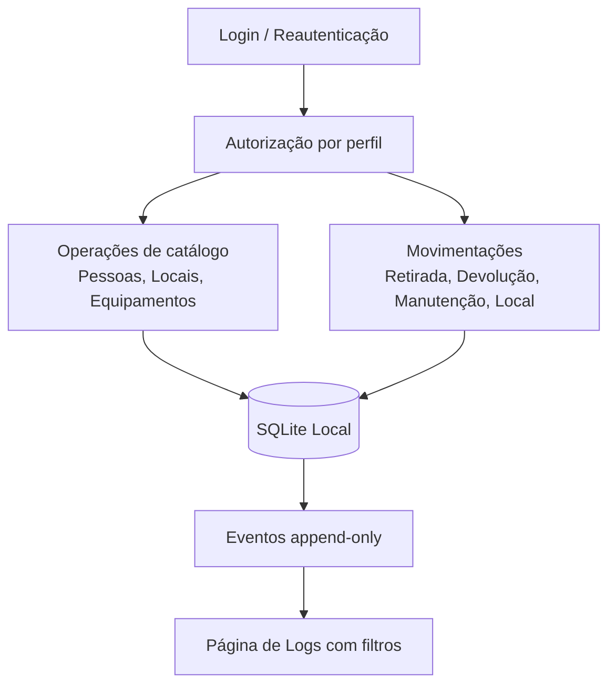

# GestaoEquipamentos


Aplicação desktop para gestão local de equipamentos (notebooks), com controle de cadastro, movimentações, pessoas, locais, contas de acesso e trilha de auditoria.

## O que o projeto faz

O sistema registra todo o ciclo operacional dos equipamentos:

- Cadastro e edição de equipamentos com patrimônio único.
- Controle de status: disponível, emprestado e manutenção.
- Registro de retirada, devolução e atualização de local.
- Cadastro de pessoas responsáveis e locais operacionais.
- Controle de contas (principal, administradores e comuns) com autenticação.
- Histórico de eventos com filtros por período, equipamento, local, pessoa, conta e tipo.

## Funcionalidades principais

- **Inventário operacional** com ações por status do equipamento.
- **Movimentações rastreáveis** (quem retirou/devolveu, quando e onde).
- **Sessão administrativa com expiração** e reautenticação.
- **Recuperação de conta principal** por autenticador/códigos de recuperação.
- **Persistência local em SQLite**, com migrações de esquema e logs append-only.

## Stack e tecnologias

- **Linguagem:** C++17
- **UI desktop:** Qt 6 (Widgets)
- **Banco local:** SQLite (via Qt SQL)
- **Build:** CMake + Ninja
- **Criptografia/segurança:** libsodium + QtKeychain
- **Testes:** Qt Test (opcional via BUILD_TESTING)

## Estrutura de pastas

```text
GestaoEquipamentos/
├── CMakeLists.txt
├── CMakePresets.json
├── cmake/
├── resources/
├── src/
│   ├── admin/
│   ├── application/
│   ├── domain/
│   ├── security/
│   ├── storage/
│   └── ui/
├── third_party/
├── tools/
└── docs/
    └── PROCESSO.md
```

## Como compilar e executar

### Pré-requisitos

- Qt 6.4+ (Widgets e SQL com driver QSQLITE; Qt Test só para os testes)
- CMake 3.21+ e Ninja
- Compilador C++17 — no Windows, **obrigatoriamente MinGW 64-bit** (o kit MSVC não é suportado)
- Python 3 (só para o script da conta principal)
- libsodium e QtKeychain: no Windows são baixadas/compiladas automaticamente; no Linux use os pacotes do sistema

Não é preciso servidor de banco, Docker nem credenciais: o banco é um arquivo SQLite local.

### Windows com Qt Creator (recomendado)

1. No Qt Maintenance Tool, instale **Qt 6.x → MinGW 64-bit** e, em *Developer and Designer Tools*, **MinGW 64-bit**, **CMake** e **Ninja**.
2. No Qt Creator: **Arquivo → Abrir arquivo ou projeto** → `CMakeLists.txt`.
3. Selecione o kit **Desktop Qt 6.x MinGW 64-bit** e clique em **Configurar projeto**.
4. Escolha *Debug* ou *Release* no seletor do canto inferior esquerdo e compile (**Ctrl+B**).

O Qt Creator **não** usa as pastas `build/dev` e `build/release` dos presets: ele cria uma pasta própria, por exemplo
`build/Desktop_Qt_6_8_3_MinGW_64_bit-Release/`. O caminho exato aparece em **Projetos → Compilar → Diretório de compilação**.

Ao final de cada compilação, o CMake deixa nessa pasta tudo o que é preciso para rodar fora do Qt Creator:

| Arquivo | Origem |
| --- | --- |
| `GestaoEquipamentos.exe`, `GestaoEquipamentosAdmin.exe` | compilados |
| `Qt6Core.dll`, `Qt6Sql.dll`, `Qt6Widgets.dll`, `platforms/`, `sqldrivers/qsqlite.dll`… | `windeployqt` do kit |
| `libgcc_s_seh-1.dll`, `libstdc++-6.dll`, `libwinpthread-1.dll` | compilador MinGW |
| `libsodium-26.dll` | libsodium baixada no configure |
| `admin_account.py` | `tools/admin_account.py` |

Para desligar essa cópia automática: `-DGESTAOEQUIPAMENTOS_DEPLOY_QT=OFF`.

### Terminal (presets)

O build padrão compila **apenas** a aplicação e a ferramenta administrativa — os testes ficam fora (`EXCLUDE_FROM_ALL`).

```bash
cmake --preset dev        # Debug,   em build/dev
cmake --build --preset dev
./build/dev/GestaoEquipamentos

cmake --preset release    # Release, em build/release (sem testes)
cmake --build --preset release
```

No Windows, rode no atalho **Qt 6.x (MinGW 64-bit)** do menu Iniciar — um terminal comum não encontra o compilador
nem o Ninja. Se o Qt não for encontrado, informe o prefixo do kit (adapte versão e caminho):

```powershell
cmake --preset release -DCMAKE_PREFIX_PATH="C:/Qt/6.8.3/mingw_64"
cmake --build --preset release
.\build\release\GestaoEquipamentos.exe
```

No Ubuntu/Debian:

```bash
sudo apt install build-essential cmake ninja-build qt6-base-dev libqt6sql6-sqlite libsodium-dev qtkeychain-qt6-dev pkg-config
```

> `build/release` vazio ou sem DLLs quase sempre significa que esse preset nunca foi compilado (o Qt Creator compila em
> outra pasta) ou que a compilação parou com erro. Confira o painel **Saída da compilação** / a saída do terminal.

### Primeira execução: criar a conta principal (admin)

Na primeira abertura não existe nenhuma conta, e o aplicativo pede que a conta principal seja configurada.
Ela é criada **fora da interface**, pelo script `admin_account.py` (Python 3, só biblioteca padrão),
que conversa com o executável `GestaoEquipamentosAdmin` via JSON pela entrada padrão. Assim a senha nunca
aparece em argumentos de linha de comando nem no histórico do terminal.

O jeito mais simples é rodar o script **dentro da pasta de build** (ele é copiado para lá a cada compilação):

```powershell
# Windows — na pasta de build (ex.: a do Qt Creator)
cd build\Desktop_Qt_6_8_3_MinGW_64_bit-Release
.\GestaoEquipamentosAdmin.exe --version    # deve imprimir: GestaoEquipamentosAdmin protocolo 1
py -3 admin_account.py bootstrap
```

```bash
# Linux / macOS
cd build/dev
python3 admin_account.py bootstrap
```

- Rode com o **mesmo usuário do sistema operacional** que usa o aplicativo: o script grava no mesmo banco local
  e não pergunta caminho de banco.
- Informe o nome de usuário e a senha (digitação oculta, com confirmação; 8 a 128 caracteres).
- Também dá para rodar a partir da raiz do projeto (`py -3 tools/admin_account.py bootstrap`): o script procura o
  `GestaoEquipamentosAdmin` ao lado dele e em todas as subpastas de `build/`, usando o mais recente. Em outro local,
  use `--helper <caminho do executável>`.
- Só funciona uma vez: se a principal já existir, a operação é recusada. Para trocar a senha, use a recuperação.
- Faça backup do banco antes de usar o script em um banco existente.

Depois disso, abra o `GestaoEquipamentos` e entre com a conta principal. Ela cria as demais contas
(até três administradores, contando a principal, e operadores) pela tela **Contas**.

#### Problemas comuns no script

| Mensagem | Causa provável | O que fazer |
| --- | --- | --- |
| `Utilitário GestaoEquipamentosAdmin não encontrado` | o alvo admin não foi compilado | compile o projeto inteiro (ou `--target GestaoEquipamentosAdmin`) e rode na pasta de build |
| `... faltam DLLs ...` (código 0xC0000135) | o `.exe` não inicia sem as DLLs do Qt/MinGW | recompile com a versão atual do CMake (copia as DLLs) ou rode `windeployqt` no `.exe` |
| `... 0xC000007B` | DLLs de outra arquitetura ou de outro compilador (MSVC × MinGW) no `PATH` | use as DLLs do mesmo kit MinGW 64-bit, ao lado do `.exe` |
| `BAD_REPLY` | o executável respondeu algo que não é o protocolo | rode `GestaoEquipamentosAdmin.exe --version` e confira a saída |

#### Recuperar a conta principal

1. Em **Contas → Vincular Google Authenticator**, leia o QR com o celular, confirme o código de 6 dígitos e guarde os
   10 **códigos de recuperação** exibidos uma única vez.
2. Se esquecer a senha, use **Recuperar conta principal** na tela de login, ou no terminal (mesmo usuário do sistema):

   ```bash
   py -3 admin_account.py recover        # Linux/macOS: python3 admin_account.py recover
   ```

   O script pede o usuário, o método (1 = Authenticator, 2 = código de recuperação) e o código; só depois de o código
   ser aceito ele pede a nova senha. Se a nova senha não for enviada em 5 minutos, nada muda e o código continua valendo.
3. Cinco códigos errados bloqueiam novas tentativas por 5 minutos. Cada tentativa recusada fica nos logs, sem o código.
4. Usar um **código de recuperação** consome o código e remove o vínculo do Authenticator: vincule de novo para gerar
   um novo conjunto de códigos.

### Demonstração

```bash
./build/dev/GestaoEquipamentos --demo
./build/dev/GestaoEquipamentos --demo --demo-150                       # listas com 150 cadastros
./build/dev/GestaoEquipamentos --demo --page logs --screenshot logs.png
```

O modo `--demo` usa um banco separado (`demo.sqlite`) com equipamentos, pessoas e locais fictícios, sem tocar no banco
real. `--page` aceita `pessoas`, `equipamentos`, `locais`, `logs` ou `logs-filtros`.

### Dados e backup

O caminho do banco aparece no rodapé do aplicativo. Ele fica em `QStandardPaths::AppLocalDataLocation`
(no Windows, dentro de `%LOCALAPPDATA%`), fora da pasta do código.

- **Backup:** feche todas as instâncias e copie `notebooks.sqlite` (e `notebooks.sqlite-wal`, se existir).
- **Atualização de esquema:** antes de migrar, o aplicativo grava `backups/<arquivo>.pre-vN-<data UTC>.bak`; se a cópia
  falhar, o banco não é alterado.
- O segredo do Authenticator fica no cofre do sistema (Gerenciador de Credenciais no Windows), **não** no SQLite.
- Nunca envie o banco operacional para o Git. Não use o SQLite em pasta de rede compartilhada.

### Pacote para outro computador (Windows)

No terminal do kit Qt MinGW:

```powershell
cmake --preset release
cmake --build --preset release
cmake --install build/release --prefix build/pacote
windeployqt.exe --compiler-runtime build/pacote/bin/GestaoEquipamentos.exe
windeployqt.exe --compiler-runtime build/pacote/bin/GestaoEquipamentosAdmin.exe
```

Copie a pasta `build/pacote` inteira para o destino (o `admin_account.py` já vai em `bin/`). O script da conta principal
precisa de Python 3 instalado lá.

### Testes (sob demanda)

Os testes usam **Qt Test** com um executável por suíte, registrados no CTest. Para compilar e rodar tudo:

```bash
cmake --build --preset dev --target check
```

Para rodar uma suíte específica depois de compilada:

```bash
cmake --build --preset dev --target store_tests
ctest --preset dev -R store_tests
```

O preset `release` desliga os testes por completo (`BUILD_TESTING=OFF`).

### Formatação do código

O estilo C++ está definido em `.clang-format` (4 espaços, 120 colunas). Para formatar:

```bash
clang-format -i src/**/*.cpp src/**/*.h tests/*.cpp tests/*.h
```

## Como funciona



## Fluxo principal em alto nível

1. Usuário autentica e abre sessão.
2. O sistema autoriza a operação conforme perfil da conta.
3. A ação é gravada no banco local (inventário/catálogos/empréstimos).
4. Um evento de histórico é anexado com metadados da operação.
5. A interface reflete o novo estado e os logs podem ser consultados com filtros.

## Licença

Este projeto está sob a licença **MIT**. Consulte o arquivo [LICENSE](LICENSE).
