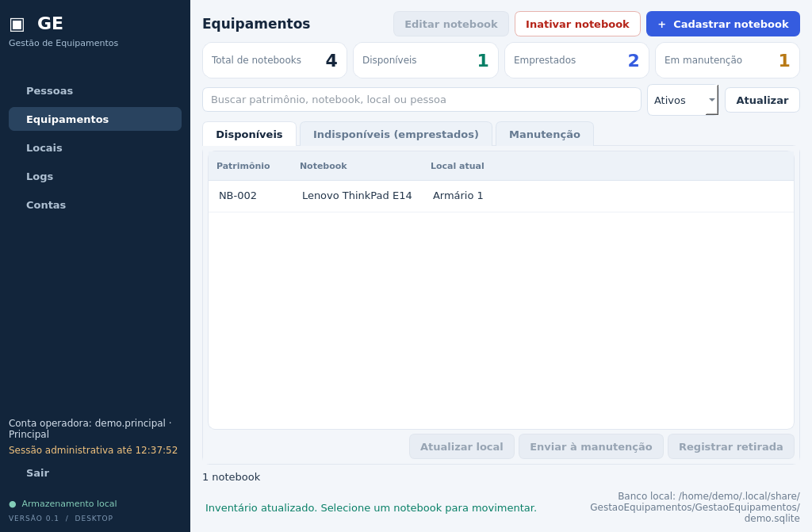
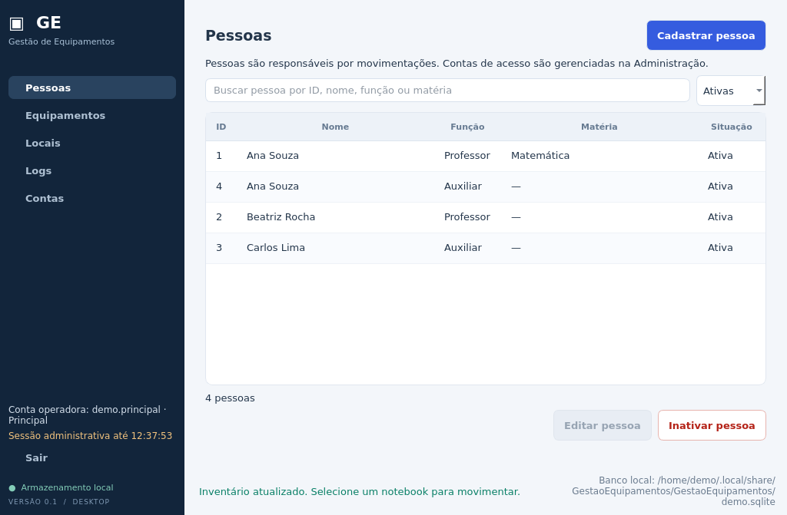
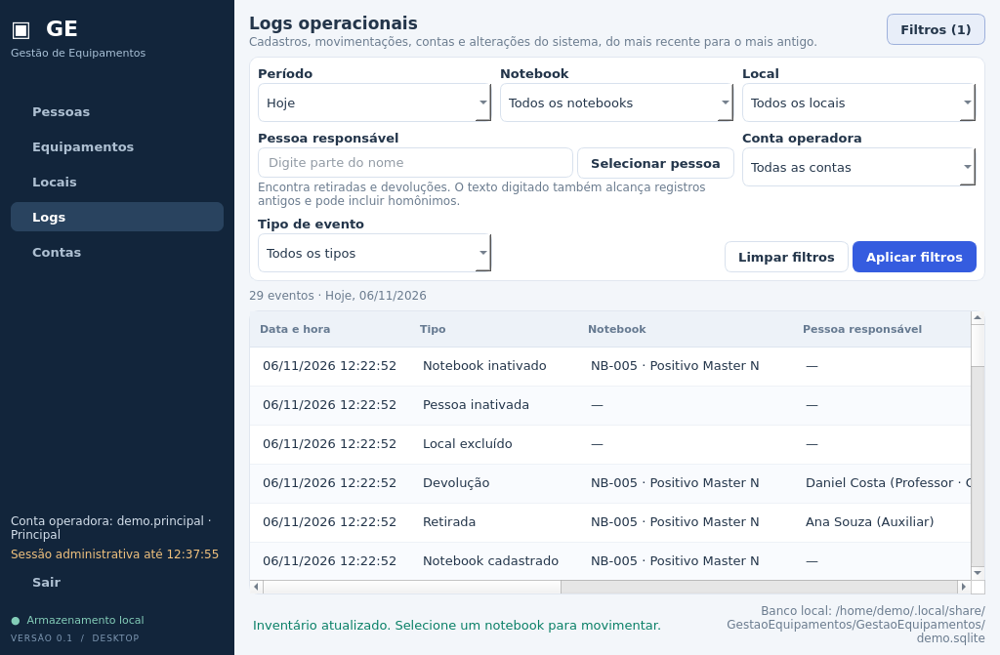
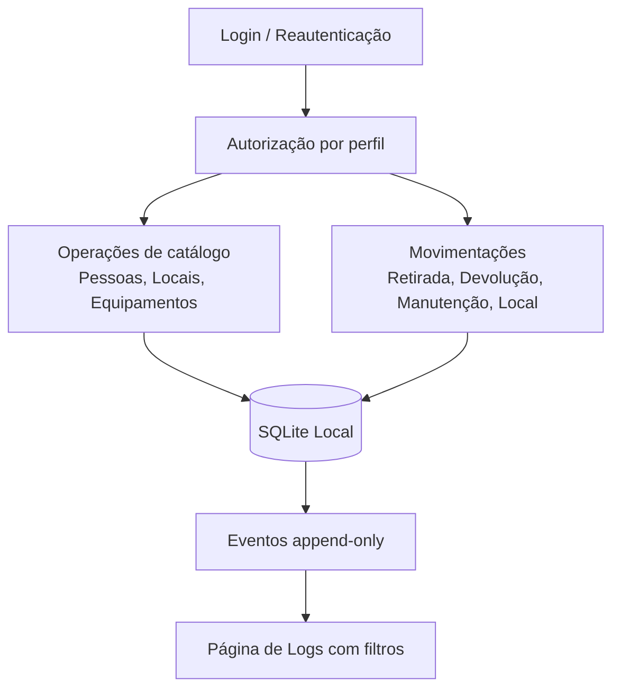

# GestaoEquipamentos


**Controle de empréstimo de notebooks e equipamentos para escolas e setores, com histórico completo de quem
retirou, quem devolveu, quando e onde.** Aplicação desktop em C++17 e Qt 6. Os dados ficam em um banco SQLite local,
sem servidor e sem internet.



## Introdução

Em muitas escolas e setores, o empréstimo de notebooks ainda é controlado em planilha ou caderno. Com o tempo,
ninguém sabe ao certo onde está cada equipamento, quem ficou com ele por último ou desde quando ele está em
manutenção.

O **GestaoEquipamentos** resolve isso com um fluxo simples:

1. Cada equipamento é cadastrado com um **patrimônio único** e um **local atual**.
2. Toda **retirada** e **devolução** registra a pessoa responsável, a função (professor ou auxiliar), o local de uso
   e a data e hora, preenchidas automaticamente.
3. O inventário mostra, em tempo real, o que está **disponível**, **emprestado** ou **em manutenção**.
4. Cada ação vira um **evento no histórico (log)**, que não pode ser editado nem apagado depois. Também fica
   registrado qual conta fez a operação.

Foi pensado para rodar em **um computador do setor**, operado por uma equipe pequena com contas e permissões
diferentes.

### Destaques

- **Histórico imutável (append-only):** triggers no SQLite impedem alterar ou apagar eventos. Edições ficam
  registradas como "de → para".
- **Contas com perfis:** principal, administradores e operadores. Sessões administrativas expiram em 15 minutos.
- **Segurança de verdade:** senhas com hash Argon2 (libsodium), segundo fator TOTP compatível com o Google
  Authenticator, códigos de recuperação de uso único e segredos guardados no cofre do sistema operacional
  (Gerenciador de Credenciais no Windows).
- **Banco versionado:** migrações automáticas de esquema, com cópia de segurança antes de cada atualização.
- **Interface em português,** ajustada para telas de notebook (1366×768) e de desktop (1920×1080).
- **Testes automatizados:** 13 suítes (Qt Test e Python) cobrindo regras de negócio, autenticação, recuperação,
  linha de comando e interface.

<table>
  <tr>
    <td></td>
    <td></td>
  </tr>
  <tr>
    <td align="center">Cadastro de pessoas</td>
    <td align="center">Histórico com filtros</td>
  </tr>
</table>

## O que você precisa saber para começar

### 1. Experimente sem tocar em dados reais

Para conhecer o sistema, abra em **modo demonstração**:

```bash
GestaoEquipamentos --demo
```

Ele cria um banco separado (`demo.sqlite`) com equipamentos, pessoas, locais e movimentações fictícias, e já entra
com a conta principal de demonstração. O banco real não é tocado.

### 2. Primeira vez de verdade: criar a conta principal

Na primeira abertura normal, o aplicativo mostra **"Configuração inicial necessária"**. Isso é esperado: ainda não
existe nenhuma conta.

A conta principal é a "dona" do sistema. Ela é criada **uma única vez**, pelo script `admin_account.py`, que fica na
mesma pasta do programa. É preciso ter Python 3 instalado:

```powershell
py -3 admin_account.py bootstrap        # Linux/macOS: python3 admin_account.py bootstrap
```

Informe um nome de usuário e uma senha de 8 a 128 caracteres. Depois, volte ao aplicativo, clique em
**Tentar novamente** e entre com essa conta.

> Rode o script **com o mesmo usuário do Windows** que vai usar o aplicativo: cada usuário do sistema tem o seu
> próprio banco. Os detalhes e as mensagens de erro mais comuns estão em
> [Primeira execução](#primeira-execução-criar-a-conta-principal-admin).

### 3. Proteja a conta principal logo no primeiro acesso

Em **Contas → Vincular Google Authenticator**, leia o QR Code com o celular e **guarde os 10 códigos de recuperação**.
Eles aparecem uma única vez e são a única forma de recuperar a conta se a senha for esquecida.

### 4. Crie as contas da equipe

Também em **Contas**, crie as contas de quem vai operar o sistema. Cada conta é criada com uma senha temporária (trocada
obrigatoriamente no primeiro acesso) ou pela definição assistida, em que a própria pessoa digita a senha na hora.

| Perfil | O que pode fazer |
| --- | --- |
| **Principal** (1) | tudo, inclusive criar administradores e configurar a recuperação |
| **Administrador** (até 2, além da principal) | criar e gerenciar operadores, inativar pessoas e equipamentos |
| **Operador** (conta comum) | cadastrar e editar pessoas, locais e equipamentos, registrar retiradas, devoluções e manutenção |

Sessões de principal e administradores **expiram em 15 minutos**, e aí é preciso entrar de novo. As de operador não
expiram. Contas não são excluídas, só inativadas, para o histórico continuar consistente.

### 5. Cadastre nesta ordem

1. **Locais** — salas, armários e laboratórios. Todo equipamento precisa de um local.
2. **Pessoas** — quem retira e devolve (professor, com matéria opcional, ou auxiliar). Pessoas **não** são contas de
   acesso.
3. **Equipamentos** — patrimônio, nome e local atual.

Também dá para cadastrar uma pessoa ou um local na hora, direto na tela de retirada ou de devolução (botões
**Adicionar pessoa** e **Adicionar local**).

### 6. Operação do dia a dia

Na tela **Equipamentos**, selecione um item e use as ações da guia:

| Guia | Ações |
| --- | --- |
| Disponíveis | Registrar retirada · Enviar à manutenção · Atualizar local |
| Indisponíveis (emprestados) | Registrar devolução · Atualizar local |
| Manutenção | Concluir manutenção |

Em **Logs**, consulte tudo o que aconteceu, com filtros por período, equipamento, local, pessoa, conta e tipo de
evento.

### 7. Onde ficam os dados e como fazer backup

- O caminho do banco aparece no **rodapé** do aplicativo. No Windows, ele fica em `%LOCALAPPDATA%`, fora da pasta do
  programa. Reinstalar ou atualizar o aplicativo não apaga os dados.
- **Backup:** feche o aplicativo e copie o arquivo `notebooks.sqlite` (e o `notebooks.sqlite-wal`, se existir).
- Esqueceu a senha da principal? Use **Recuperar conta principal**, na tela de login, com o Authenticator ou um dos
  códigos de recuperação.

### Limitações atuais

- **Uso local, em um computador.** Não há sincronização entre máquinas, e o banco não deve ficar em pasta de rede
  compartilhada.
- A conta principal ainda é criada por um script em Python. Um assistente dentro do próprio aplicativo e um
  instalador para Windows estão nos próximos passos.
- Ainda não há instalador pronto: por enquanto, o programa é compilado a partir do código (veja abaixo).

---

## Stack e tecnologias

| Área | Tecnologia |
| --- | --- |
| Linguagem | C++17 |
| Interface | Qt 6 Widgets, com tema próprio em QSS |
| Banco | SQLite via Qt SQL (WAL, chaves estrangeiras, triggers) |
| Segurança | libsodium (Argon2id), TOTP (RFC 6238), QtKeychain |
| QR Code | qrcodegen (Nayuki), incluído em `third_party/` |
| Build | CMake 3.21+ e Ninja, com presets `dev` e `release` |
| Testes | Qt Test e CTest, mais `unittest` para o script Python |

## Estrutura de pastas

```text
GestaoEquipamentos/
├── CMakeLists.txt          # alvos: GestaoEquipamentos, GestaoEquipamentosAdmin e testes
├── CMakePresets.json       # presets dev (Debug + testes) e release
├── cmake/                  # dependências e implantação no Windows (windeployqt)
├── resources/              # folha de estilo (QSS) e recursos Qt
├── src/
│   ├── admin/              # ferramenta de linha de comando (protocolo JSON)
│   ├── application/        # regras de negócio: contas, autenticação, pessoas, locais, histórico
│   ├── domain/             # modelos: equipamento, conta, eventos, filtros
│   ├── security/           # hash de senha, TOTP, códigos de recuperação, cofre de segredos
│   ├── storage/            # SQLite, migrações e inventário
│   └── ui/                 # janelas, páginas e diálogos
├── tests/                  # suítes Qt Test e teste do script
├── tools/admin_account.py  # criação e recuperação da conta principal
├── third_party/            # qrcodegen
└── docs/PROCESSO.md        # como o sistema funciona por dentro
```

## Para desenvolvedores: como compilar e executar

### Pré-requisitos

- Qt 6.4+ (Widgets e SQL com driver QSQLITE; Qt Test só para os testes)
- CMake 3.21+ e Ninja
- Compilador C++17 — no Windows, **obrigatoriamente MinGW 64-bit** (o kit MSVC não é suportado)
- Python 3 (só para o script da conta principal)
- libsodium e QtKeychain: no Windows são baixadas/compiladas automaticamente; no Linux use os pacotes do sistema

Não é preciso servidor de banco, Docker nem credenciais: o banco é um arquivo SQLite local.

### Windows com Qt Creator (recomendado)

1. No Qt Maintenance Tool, instale **Qt 6.x → MinGW 64-bit** e, em *Developer and Designer Tools*, **MinGW 64-bit**, **CMake** e **Ninja**.
2. No Qt Creator: **Arquivo → Abrir arquivo ou projeto** → `CMakeLists.txt`.
3. Selecione o kit **Desktop Qt 6.x MinGW 64-bit** e clique em **Configurar projeto**.
4. Escolha *Debug* ou *Release* no seletor do canto inferior esquerdo e compile (**Ctrl+B**).

O Qt Creator **não** usa as pastas `build/dev` e `build/release` dos presets: ele cria uma pasta própria, por exemplo
`build/Desktop_Qt_6_8_3_MinGW_64_bit-Release/`. O caminho exato aparece em **Projetos → Compilar → Diretório de compilação**.

Ao final de cada compilação, o CMake deixa nessa pasta tudo o que é preciso para rodar fora do Qt Creator:

| Arquivo | Origem |
| --- | --- |
| `GestaoEquipamentos.exe`, `GestaoEquipamentosAdmin.exe` | compilados |
| `Qt6Core.dll`, `Qt6Sql.dll`, `Qt6Widgets.dll`, `platforms/`, `sqldrivers/qsqlite.dll`… | `windeployqt` do kit |
| `libgcc_s_seh-1.dll`, `libstdc++-6.dll`, `libwinpthread-1.dll` | compilador MinGW |
| `libsodium-26.dll` | libsodium baixada no configure |
| `admin_account.py` | `tools/admin_account.py` |

Para desligar essa cópia automática: `-DGESTAOEQUIPAMENTOS_DEPLOY_QT=OFF`.

### Terminal (presets)

O build padrão compila **apenas** a aplicação e a ferramenta administrativa — os testes ficam fora (`EXCLUDE_FROM_ALL`).

```bash
cmake --preset dev        # Debug,   em build/dev
cmake --build --preset dev
./build/dev/GestaoEquipamentos

cmake --preset release    # Release, em build/release (sem testes)
cmake --build --preset release
```

No Windows, rode no atalho **Qt 6.x (MinGW 64-bit)** do menu Iniciar — um terminal comum não encontra o compilador
nem o Ninja. Se o Qt não for encontrado, informe o prefixo do kit (adapte versão e caminho):

```powershell
cmake --preset release -DCMAKE_PREFIX_PATH="C:/Qt/6.8.3/mingw_64"
cmake --build --preset release
.\build\release\GestaoEquipamentos.exe
```

No Ubuntu/Debian:

```bash
sudo apt install build-essential cmake ninja-build qt6-base-dev libqt6sql6-sqlite libsodium-dev qtkeychain-qt6-dev pkg-config
```

> `build/release` vazio ou sem DLLs quase sempre significa que esse preset nunca foi compilado (o Qt Creator compila em
> outra pasta) ou que a compilação parou com erro. Confira o painel **Saída da compilação** / a saída do terminal.

### Primeira execução: criar a conta principal (admin)

Na primeira abertura não existe nenhuma conta, e o aplicativo pede que a conta principal seja configurada.
Ela é criada **fora da interface**, pelo script `admin_account.py` (Python 3, só biblioteca padrão),
que conversa com o executável `GestaoEquipamentosAdmin` via JSON pela entrada padrão. Assim a senha nunca
aparece em argumentos de linha de comando nem no histórico do terminal.

O jeito mais simples é rodar o script **dentro da pasta de build** (ele é copiado para lá a cada compilação):

```powershell
# Windows — na pasta de build (ex.: a do Qt Creator)
cd build\Desktop_Qt_6_8_3_MinGW_64_bit-Release
.\GestaoEquipamentosAdmin.exe --version    # deve imprimir: GestaoEquipamentosAdmin protocolo 1
py -3 admin_account.py bootstrap
```

```bash
# Linux / macOS
cd build/dev
python3 admin_account.py bootstrap
```

- Rode com o **mesmo usuário do sistema operacional** que usa o aplicativo: o script grava no mesmo banco local
  e não pergunta caminho de banco.
- Informe o nome de usuário e a senha (digitação oculta, com confirmação; 8 a 128 caracteres).
- Também dá para rodar a partir da raiz do projeto (`py -3 tools/admin_account.py bootstrap`): o script procura o
  `GestaoEquipamentosAdmin` ao lado dele e em todas as subpastas de `build/`, usando o mais recente. Em outro local,
  use `--helper <caminho do executável>`.
- Só funciona uma vez: se a principal já existir, a operação é recusada. Para trocar a senha, use a recuperação.
- Faça backup do banco antes de usar o script em um banco existente.

Depois disso, abra o `GestaoEquipamentos` e entre com a conta principal. Ela cria as demais contas
(até três administradores, contando a principal, e operadores) pela tela **Contas**.

#### Problemas comuns no script

| Mensagem | Causa provável | O que fazer |
| --- | --- | --- |
| `Utilitário GestaoEquipamentosAdmin não encontrado` | o alvo admin não foi compilado | compile o projeto inteiro (ou `--target GestaoEquipamentosAdmin`) e rode na pasta de build |
| `... faltam DLLs ...` (código 0xC0000135) | o `.exe` não inicia sem as DLLs do Qt/MinGW | recompile com a versão atual do CMake (copia as DLLs) ou rode `windeployqt` no `.exe` |
| `... 0xC000007B` | DLLs de outra arquitetura ou de outro compilador (MSVC × MinGW) no `PATH` | use as DLLs do mesmo kit MinGW 64-bit, ao lado do `.exe` |
| `BAD_REPLY` | o executável respondeu algo que não é o protocolo | rode `GestaoEquipamentosAdmin.exe --version` e confira a saída |

#### Recuperar a conta principal

1. Em **Contas → Vincular Google Authenticator**, leia o QR com o celular, confirme o código de 6 dígitos e guarde os
   10 **códigos de recuperação** exibidos uma única vez.
2. Se esquecer a senha, use **Recuperar conta principal** na tela de login, ou no terminal (mesmo usuário do sistema):

   ```bash
   py -3 admin_account.py recover        # Linux/macOS: python3 admin_account.py recover
   ```

   O script pede o usuário, o método (1 = Authenticator, 2 = código de recuperação) e o código; só depois de o código
   ser aceito ele pede a nova senha. Se a nova senha não for enviada em 5 minutos, nada muda e o código continua valendo.
3. Cinco códigos errados bloqueiam novas tentativas por 5 minutos. Cada tentativa recusada fica nos logs, sem o código.
4. Usar um **código de recuperação** consome o código e remove o vínculo do Authenticator: vincule de novo para gerar
   um novo conjunto de códigos.

### Demonstração

```bash
./build/dev/GestaoEquipamentos --demo
./build/dev/GestaoEquipamentos --demo --demo-150                       # listas com 150 cadastros
./build/dev/GestaoEquipamentos --demo --page logs --screenshot logs.png
```

O modo `--demo` usa um banco separado (`demo.sqlite`) com equipamentos, pessoas e locais fictícios, sem tocar no banco
real. `--page` aceita `pessoas`, `equipamentos`, `locais`, `logs` ou `logs-filtros`.

### Dados e backup

O caminho do banco aparece no rodapé do aplicativo. Ele fica em `QStandardPaths::AppLocalDataLocation`
(no Windows, dentro de `%LOCALAPPDATA%`), fora da pasta do código.

- **Backup:** feche todas as instâncias e copie `notebooks.sqlite` (e `notebooks.sqlite-wal`, se existir).
- **Atualização de esquema:** antes de migrar, o aplicativo grava `backups/<arquivo>.pre-vN-<data UTC>.bak`; se a cópia
  falhar, o banco não é alterado.
- O segredo do Authenticator fica no cofre do sistema (Gerenciador de Credenciais no Windows), **não** no SQLite.
- Nunca envie o banco operacional para o Git. Não use o SQLite em pasta de rede compartilhada.

### Pacote para outro computador (Windows)

No terminal do kit Qt MinGW:

```powershell
cmake --preset release
cmake --build --preset release
cmake --install build/release --prefix build/pacote
windeployqt.exe --compiler-runtime build/pacote/bin/GestaoEquipamentos.exe
windeployqt.exe --compiler-runtime build/pacote/bin/GestaoEquipamentosAdmin.exe
```

Copie a pasta `build/pacote` inteira para o destino (o `admin_account.py` já vai em `bin/`). O script da conta principal
precisa de Python 3 instalado lá.

### Testes (sob demanda)

Os testes usam **Qt Test** com um executável por suíte, registrados no CTest. Para compilar e rodar tudo:

```bash
cmake --build --preset dev --target check
```

Para rodar uma suíte específica depois de compilada:

```bash
cmake --build --preset dev --target store_tests
ctest --preset dev -R store_tests
```

O preset `release` desliga os testes por completo (`BUILD_TESTING=OFF`).

### Formatação do código

O estilo C++ está definido em `.clang-format` (4 espaços, 120 colunas). Para formatar:

```bash
clang-format -i src/**/*.cpp src/**/*.h tests/*.cpp tests/*.h
```

## Como funciona

O detalhamento por camadas está em [docs/PROCESSO.md](docs/PROCESSO.md).



## Fluxo principal em alto nível

1. Usuário autentica e abre sessão.
2. O sistema autoriza a operação conforme perfil da conta.
3. A ação é gravada no banco local (inventário/catálogos/empréstimos).
4. Um evento de histórico é anexado com metadados da operação.
5. A interface reflete o novo estado e os logs podem ser consultados com filtros.

## Licença

Este projeto está sob a licença **MIT**. Consulte o arquivo [LICENSE](LICENSE).
