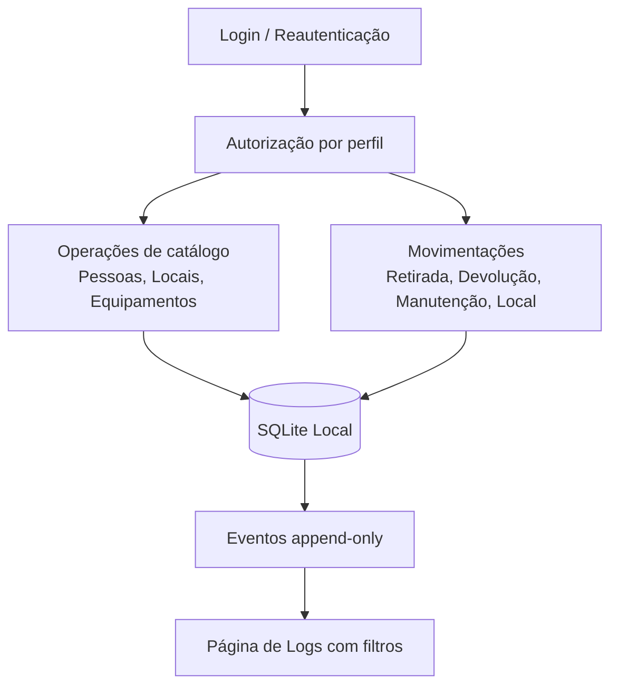

# GestaoEquipamentos


Aplicação desktop para gestão local de equipamentos (notebooks), com controle de cadastro, movimentações, pessoas, locais, contas de acesso e trilha de auditoria.

## O que o projeto faz

O sistema registra todo o ciclo operacional dos equipamentos:

- Cadastro e edição de equipamentos com patrimônio único.
- Controle de status: disponível, emprestado e manutenção.
- Registro de retirada, devolução e atualização de local.
- Cadastro de pessoas responsáveis e locais operacionais.
- Controle de contas (principal, administradores e comuns) com autenticação.
- Histórico de eventos com filtros por período, equipamento, local, pessoa, conta e tipo.

## Funcionalidades principais

- **Inventário operacional** com ações por status do equipamento.
- **Movimentações rastreáveis** (quem retirou/devolveu, quando e onde).
- **Sessão administrativa com expiração** e reautenticação.
- **Recuperação de conta principal** por autenticador/códigos de recuperação.
- **Persistência local em SQLite**, com migrações de esquema e logs append-only.

## Stack e tecnologias

- **Linguagem:** C++17
- **UI desktop:** Qt 6 (Widgets)
- **Banco local:** SQLite (via Qt SQL)
- **Build:** CMake + Ninja
- **Criptografia/segurança:** libsodium + QtKeychain
- **Testes:** Qt Test (opcional via BUILD_TESTING)

## Estrutura de pastas

```text
GestaoEquipamentos/
├── CMakeLists.txt
├── CMakePresets.json
├── cmake/
├── resources/
├── src/
│   ├── admin/
│   ├── application/
│   ├── domain/
│   ├── security/
│   ├── storage/
│   └── ui/
├── third_party/
├── tools/
└── docs/
    └── PROCESSO.md
```

## Como compilar e executar

### Pré-requisitos

- Qt 6.4+ (Widgets e SQL com driver QSQLITE)
- CMake 3.21+
- Ninja
- Compilador C++17
- libsodium e QtKeychain (ou resolução automática conforme plataforma/configuração)

> **Windows:** use o kit **Qt MinGW 64-bit** (pelo Qt Creator ou pelo atalho de terminal do kit no menu Iniciar).
> Um terminal comum não encontra o Ninja nem o compilador.

### Build da aplicação

O build padrão compila **apenas** a aplicação e a ferramenta administrativa — os testes ficam fora (`EXCLUDE_FROM_ALL`).

```bash
cmake --preset dev        # ou: cmake --preset release
cmake --build --preset dev
./build/dev/GestaoEquipamentos
```

### Primeira execução: criar a conta principal (admin)

Na primeira abertura não existe nenhuma conta, e o aplicativo pede que a conta principal seja configurada.
Ela é criada **fora da interface**, pelo script `tools/admin_account.py` (Python 3, só biblioteca padrão),
que conversa com o executável `GestaoEquipamentosAdmin` via JSON pela entrada padrão. Assim a senha nunca
aparece em argumentos de linha de comando nem no histórico do terminal.

```bash
# Windows
py -3 tools/admin_account.py bootstrap

# Linux / macOS
python3 tools/admin_account.py bootstrap
```

- Rode com o **mesmo usuário do sistema operacional** que usa o aplicativo: o script grava no mesmo banco local
  e não pergunta caminho de banco.
- Informe o nome de usuário e a senha (digitação oculta, com confirmação; 8 a 128 caracteres).
- O script procura o `GestaoEquipamentosAdmin` ao lado dele, em `build/release`, `build/dev` e em subpastas de `build/` (layout do Qt Creator).
  Em outro local, use `--helper <caminho do executável>`.
- Se aparecer "Utilitário GestaoEquipamentosAdmin não encontrado", compile o alvo admin explicitamente:

  ```bash
  cmake --build --preset release --target GestaoEquipamentosAdmin
  ```

  e rode com `--helper`, por exemplo no Windows:

  ```bash
  py -3 tools/admin_account.py bootstrap --helper build\\release\\GestaoEquipamentosAdmin.exe
  ```

- Só funciona uma vez: se a principal já existir, a operação é recusada. Para trocar a senha, use a recuperação.

Depois disso, abra o `GestaoEquipamentos` e entre com a conta principal. Ela cria as demais contas
(administradores e operadores) pela tela **Contas**.

#### Recuperar a conta principal

Com o Google Authenticator vinculado (tela **Contas**) ou um dos códigos de recuperação guardados:

```bash
python3 tools/admin_account.py recover
```

O script pede o usuário, o método (Authenticator ou código de recuperação) e o código; só depois de o código
ser aceito ele pede a nova senha. Cinco códigos errados bloqueiam novas tentativas por 5 minutos.

### Testes (sob demanda)

Os testes usam **Qt Test** com um executável por suíte, registrados no CTest. Para compilar e rodar tudo:

```bash
cmake --build --preset dev --target check
```

Para rodar uma suíte específica depois de compilada:

```bash
cmake --build --preset dev --target store_tests
ctest --preset dev -R store_tests
```

O preset `release` desliga os testes por completo (`BUILD_TESTING=OFF`).

### Formatação do código

O estilo C++ está definido em `.clang-format` (4 espaços, 120 colunas). Para formatar:

```bash
clang-format -i src/**/*.cpp src/**/*.h tests/*.cpp tests/*.h
```

## Como funciona



## Fluxo principal em alto nível

1. Usuário autentica e abre sessão.
2. O sistema autoriza a operação conforme perfil da conta.
3. A ação é gravada no banco local (inventário/catálogos/empréstimos).
4. Um evento de histórico é anexado com metadados da operação.
5. A interface reflete o novo estado e os logs podem ser consultados com filtros.

## Licença

Este projeto está sob a licença **MIT**. Consulte o arquivo [LICENSE](LICENSE).
