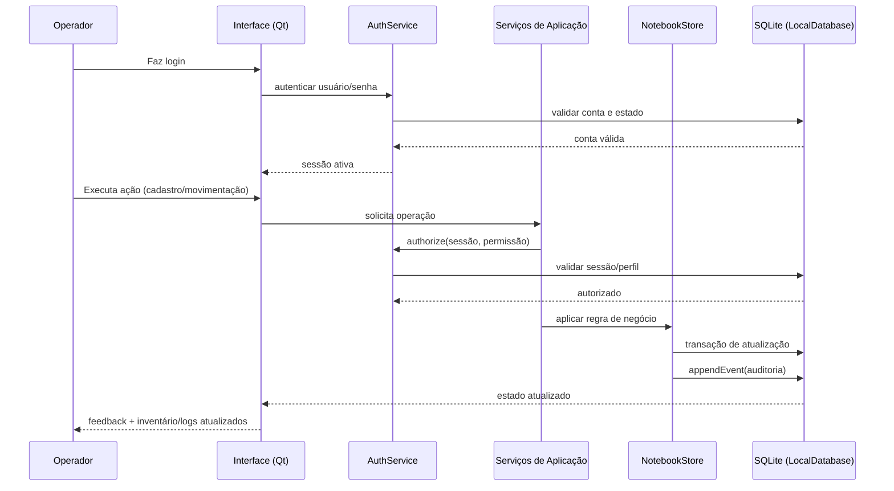

# Processo operacional do GestaoEquipamentos

Este documento descreve, com base no código-fonte, como o processo principal funciona do início ao fim.

## Visão geral da arquitetura

A aplicação segue uma divisão por camadas:

- **UI (`src/ui`)**: telas, diálogos e interação do operador.
- **Aplicação (`src/application`)**: regras de autenticação, contas, pessoas, locais, recuperação e consultas.
- **Domínio (`src/domain`)**: modelos e filtros de histórico.
- **Persistência (`src/storage`)**: acesso SQLite, transações e registro de eventos.
- **Segurança (`src/security`)**: hash de senha, TOTP/códigos de recuperação e cofre de segredos.

## Componentes centrais

### 1) Inicialização e sessão

Entrada principal em `src/main.cpp`:

1. Define identidade da aplicação (`LocalDatabase::applyApplicationIdentity`).
2. Resolve o caminho do banco local por perfil operacional ou demo.
3. Inicializa serviços: `AuthService`, `NotebookStore`, `AccountService`, `LocationService`, `PeopleService`, `RecoveryService`.
4. Se ainda não existe conta principal, mostra o aviso de configuração pendente (`BootstrapPendingDialog`).
5. Exibe login e cria sessão.
6. Abre a janela principal (`MainWindow`) com o contexto de serviços.

#### Configuração da conta principal (fora da interface)

A conta principal não é criada pela interface gráfica, e sim pelo script `tools/admin_account.py`:

```text
admin_account.py ──(JSON pela entrada padrão)──> GestaoEquipamentosAdmin ──> AdminProtocol ──> AuthService / RecoveryService ──> SQLite
```

1. O script pede usuário e senha com digitação oculta (`getpass`) e procura o executável `GestaoEquipamentosAdmin`
   (ao lado do script, em `build/release` ou em `build/dev`, ou pelo `--helper`).
2. Cada requisição é uma linha JSON (`bootstrap` ou `recover`); a resposta é lida antes da próxima.
   A senha nunca vai em argumento de linha de comando.
3. `GestaoEquipamentosAdmin` (`src/admin/admin_main.cpp`) abre o mesmo banco do aplicativo para o usuário
   atual do sistema e repassa a requisição ao `AdminProtocol`.
4. `bootstrap` só é aceito se não houver principal; na recuperação o código (Authenticator ou de recuperação)
   é conferido antes de a nova senha ser pedida, e código e senha são gravados juntos na mesma transação.

### 2) Banco local e migrações

Em `src/storage/LocalDatabase.cpp`:

- Banco SQLite com `PRAGMA foreign_keys=ON` e `journal_mode=WAL`.
- Controle de versão de esquema (`user_version`) com cadeia de migrações até a versão atual.
- Antes de upgrade de esquema, gera backup local automático.
- Toda escrita relevante ocorre dentro de transação.
- Eventos são **append-only**: sem alteração/exclusão posterior via triggers.

### 3) Autenticação e autorização

Em `src/application/AuthService.cpp`:

- Login por usuário/senha com normalização de nome de usuário.
- Senhas validadas por política de tamanho e verificadas via `PasswordHasher`.
- Sessões administrativas têm expiração por tempo.
- Cada operação protegida exige autorização transacional (`authorize`).
- Permissões controlam ações como operação de inventário, gestão de contas e inativação.

### 4) Inventário e movimentações

Em `src/storage/NotebookStore.cpp` e `src/ui/MainWindow.cpp`:

- Cadastro de notebook exige patrimônio, nome e local ativo.
- Movimentações principais:
  - **Retirada**: disponível → emprestado.
  - **Devolução**: emprestado → disponível.
  - **Manutenção**: disponível ↔ manutenção.
  - **Atualização de local**: disponível/emprestado.
- Validações impedem transições inválidas e alterações em registros inativos.
- Cada mudança de estado gera evento auditável com dados do ator e contexto.

### 5) Catálogos de Pessoas e Locais

- `PeopleService`: cria, edita e inativa pessoas responsáveis (professor/auxiliar).
- `LocationService`: cria, renomeia e faz exclusão lógica de locais.
- Regras de consistência são aplicadas dentro de transações.
- Alterações também são registradas em eventos.

### 6) Histórico operacional (Logs)

`LogsPage` consulta `HistoryQueryService` para:

- Exibir eventos ordenados por data/hora.
- Filtrar por período, notebook, local, pessoa, conta operadora e tipo.
- Mostrar resumo aplicado e limite de paginação de eventos.

## Sequência do fluxo principal



## Entradas e saídas do processo

### Entradas

- Credenciais de login.
- Dados de cadastro (equipamento, pessoa, local).
- Ações operacionais (retirada/devolução/manutenção/local).
- Filtros de consulta de logs.

### Saídas

- Estado persistido do inventário no SQLite local.
- Registros de empréstimos e devoluções.
- Eventos históricos auditáveis para rastreabilidade.
- Interface atualizada com feedback ao operador.

## Garantias e restrições observadas no código

- Operações de escrita exigem transação ativa.
- Histórico é imutável (append-only).
- Recursos inativos não podem ser manipulados operacionalmente.
- Regras de permissão são aplicadas antes de operações críticas.
- Sessões administrativas expiram e exigem nova autenticação.
